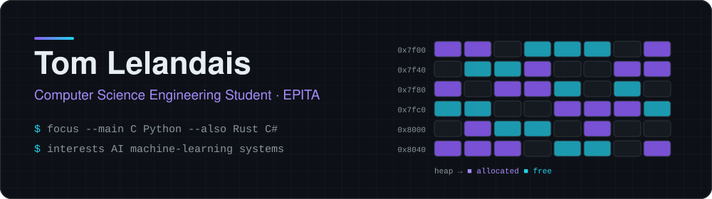
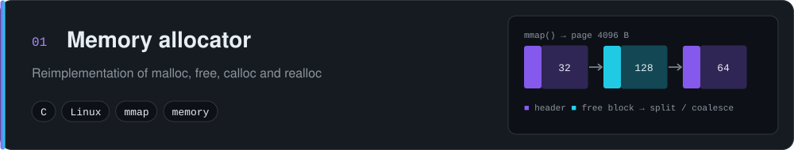
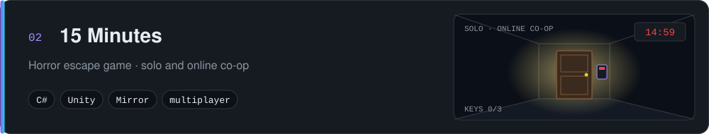
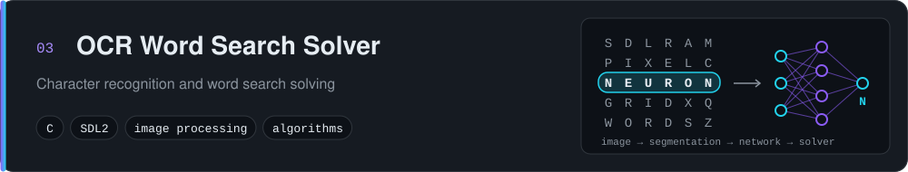
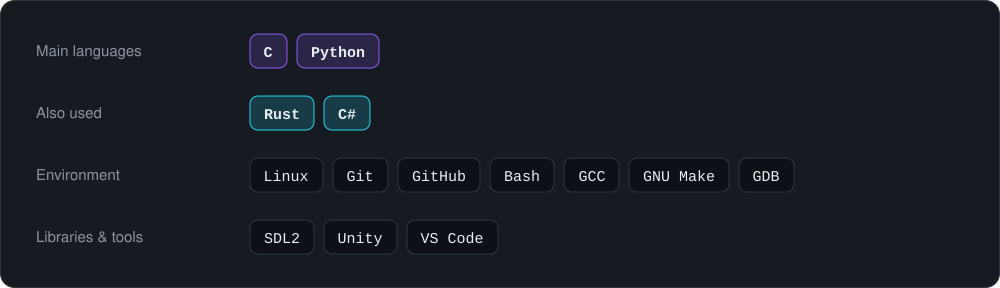
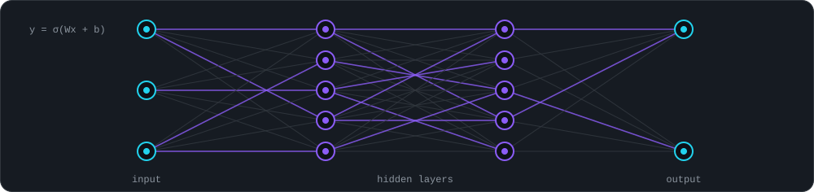

  

**Computer science engineering student at EPITA, based in Paris, France.**  
I enjoy understanding how software really works, from memory management to artificial intelligence models.

 

An academic EPITA project: a reimplementation of `malloc`, `calloc`, `realloc` and `free` in C. Memory is obtained through `mmap`, then managed with block metadata, splitting and coalescing of free blocks.

> The code stays private, in line with my school's academic rules. I'm happy to walk through it in an interview.

 

A team project at EPITA: a horror escape game in which the player, an urban explorer trapped in a haunted manor, has 15 minutes to solve puzzles and get out, alone or in online co-op.

My role: **developer, scriptwriter and creator of the project website**.
- **C# programming:** the **door** system (locked doors, key-based doors, multiplayer sync), the **inventory** (picking up and using items) and the **puzzles** (code-locked chest, keys to find).
- **Story:** the narrative for both the solo and online modes.
- **Website:** designed and deployed the project's showcase site.

**→ [Visit the project website](https://one5-minutes.onrender.com)**

 

A team project at EPITA: a C program that reads a word-search grid from an image, recognizes each letter and finds the requested words. The pipeline goes from image preprocessing (SDL2) to grid segmentation, character recognition with a **neural network**, and finally solving the grid.

My contribution:
- **Image segmentation:** detecting the grid and the word list, then isolating each letter for recognition.
- **Solving algorithm:** searching for the words in the grid in every direction (horizontal, vertical and diagonal).

> The team repository will be made public soon.

 

My main languages are **C and Python**. I have also used **Rust** and **C#** through coursework and projects.

 

I'm passionate about **artificial intelligence**: understanding how a model learns, from neural networks to the mathematics behind them. I'm also drawn to **systems programming** and **low-level development**, to see what really happens under the hood.

 

  

